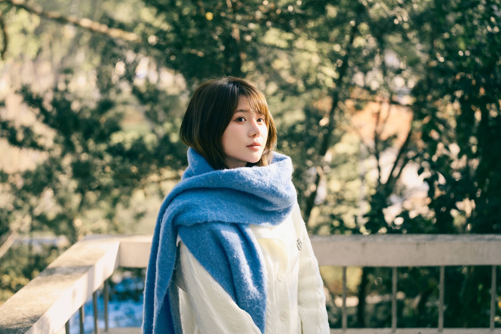

# 微信朋友圈照片压缩实测

同一张照片，直接发朋友圈和先缩图再发，接收端能保留多少细节？我们用枫叶、杂志与人像做了三组对照。每组收录一张相机原图和三张真实回收图。

[枫叶](maple/README.md)　 ·　 [杂志](print/README.md)　 ·　 [人像](portrait/README.md)　 ·　 [实验结果](#实验结果)

## 枫叶 · 叶尖与交错的枝条

画面从左数约五分之一处，取中部红叶与背景重叠的区域。 [查看四个版本与 105% 细节 →](maple/README.md)

## 杂志 · 纸面上的竖排小字

取左页「水道事業会計」标题右侧的正文，可沿同一列观察细笔画与纸面颗粒。 [查看四个版本与 175% 细节 →](print/README.md)

## 人像 · 发丝、眼周与肤色

取人物头部，可对照头发与背景的交界、眼周轮廓和脸颊上的色调过渡。 [查看四个版本与 105% 细节 →](portrait/README.md)

## 实验结果

| 场景 | 原图直发 | Photoshop 普通两次立方 | 新方案 |
|---|---:|---:|---:|
| 枫叶 | 66.97 | 70.89 | 71.47 |
| 杂志 | 72.31 | 73.48 | 73.68 |
| 人像 | 74.69 | 75.64 | 75.87 |

三张照片中，先缩图再发的评分均高于原图直发。新方案相对 Photoshop 的分差，枫叶为 0.58，杂志为 0.20，人像为 0.23。小分差是否可见，可以对照各场景的独立细节图判断。

## 实验方法

两种预处理都输出 2880 × 1920 的 PNG。Photoshop 使用「两次立方（平滑渐变）」。新方案使用 Lanczos3 缩图，模拟 JPEG Q70、4:2:0 重压，结合像素误差与感知评分选择色度补偿系数。枫叶、杂志和人像依次选中 0.75、0.25 和 0。

评分指标为 SSIMULACRA2，参考图为同尺寸的 Lanczos3 缩图，与新方案共用缩图方式。分数越高，表示越接近该参考图。结论限于这三张样本和本次朋友圈发送条件。

公开的完整 JPEG 移除了拍摄元数据，解码像素与本地文件一致。GitHub 会按页面宽度显示照片，进入场景后点击单张图片即可打开原尺寸文件。
