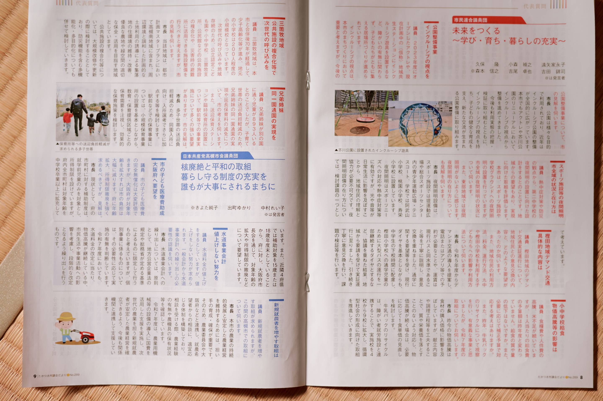

# 微信朋友圈照片压缩实测

同一张照片，直接发朋友圈和先缩图再发，接收端能保留多少细节？我们用枫叶、杂志与人像做了三组对照。每组收录一张相机原图和三张真实回收图。

[枫叶](maple/README.md)　 ·　 [杂志](print/README.md)　 ·　 [人像](portrait/README.md)　 ·　 [实验结果](#实验结果)

## 枫叶 · 叶尖与交错的枝条

画面从左数约五分之一处，取中部红叶与背景重叠的区域。 [查看四个版本与 105% 细节 →](maple/README.md)

## 杂志 · 纸面上的竖排小字

取左页「水道事業会計」标题右侧的正文，可沿同一列观察细笔画与纸面颗粒。 [查看四个版本与 175% 细节 →](print/README.md)

## 人像 · 发丝、眼周与肤色

取人物头部，可对照头发与背景的交界、眼周轮廓和脸颊上的色调过渡。 [查看四个版本与 105% 细节 →](portrait/README.md)

## 实验结果

| 场景 | 发送方式 | 发送文件 MB | 实收文件 MB | 平均色差 ΔE76 ↓ | 新增粗糙度 ↓ | 综合评分 ↑ |
|---|---|---:|---:|---:|---:|---:|
| 枫叶 | 原图直发 | 18.653 | 1.043 | 4.341 | 1.941 | 66.97 |
| 枫叶 | Photoshop | 16.598 | 1.100 | 4.234 | 2.493 | 70.89 |
| 枫叶 | 新方案 | 10.534 | 1.120 | 4.219 | 2.569 | 71.47 |
| 杂志 | 原图直发 | 11.264 | 0.524 | 1.979 | 1.042 | 72.31 |
| 杂志 | Photoshop | 16.597 | 0.550 | 1.946 | 1.306 | 73.48 |
| 杂志 | 新方案 | 7.233 | 0.553 | 1.945 | 1.341 | 73.68 |
| 人像 | 原图直发 | 19.471 | 0.438 | 1.682 | 0.508 | 74.69 |
| 人像 | Photoshop | 16.598 | 0.461 | 1.674 | 0.628 | 75.64 |
| 人像 | 新方案 | 7.969 | 0.461 | 1.672 | 0.635 | 75.87 |

发送和实收大小取自当时的本地文件，1 MB = 1,000,000 字节。公开 JPEG 副本移除了拍摄元数据，因此下载大小可能略有不同。

### 怎么读这些指标

三项指标都比较整张实收图和相机原图经 Lanczos3 缩至 2880 × 1920 的参考图。新方案也使用这一缩图方式。看图时可以另外对照直接从相机原图裁出的原生像素。

- **平均色差 ΔE76**。按 sRGB 解码，转换到 D65 白点的 CIELAB，计算每对对应像素在 L*、a*、b* 三个维度的欧氏距离，再取全图平均。数值越小，颜色与明暗越接近参考。它衡量偏离的幅度，无法单凭此值判断整幅图偏红或偏绿。
- **新增粗糙度**。本报告采用一个辅助量衡量局部亮度跳变。以 8 位 sRGB 的加权亮度 Y′ = 0.2126R′ + 0.7152G′ + 0.0722B′，计算每个像素与右、下邻点的亮度差，两方向合成梯度幅值 G。全图取 max(G实收 − G参考, 0) 的平均值，略去最右列和最下行。数值越大，额外的亮度跳变越强。锐化、噪点或压缩边界都可能提高它，模糊也可能降低它，需结合细节图和综合分解读。
- **综合评分 SSIMULACRA2**。算法在 XYB 色彩空间按六种尺度比较结构差异、额外边缘及模糊导致的细节损失，再加权汇总。100 分表示与参考一致，分数越高代表越接近参考。文件大小、上列色差和粗糙度均单独报告。[算法作者的说明与源码](https://github.com/cloudinary/ssimulacra2#how-it-works)

## 实验方法

两种预处理都输出 2880 × 1920 的 PNG。Photoshop 使用「两次立方（平滑渐变）」。新方案使用 Lanczos3 缩图，模拟 JPEG Q70、4:2:0 重压，结合像素误差与感知评分选择色度补偿系数。枫叶、杂志和人像依次选中 0.75、0.25 和 0。

结论限于三张照片及此次朋友圈发送条件。
