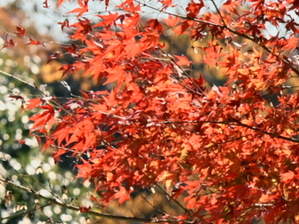
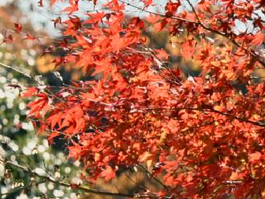
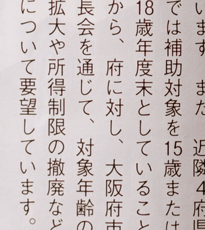
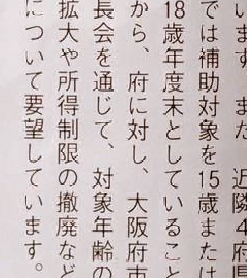

# 微信朋友圈照片压缩实测

**131 张照片，快速 CNN 轻量 JPG 的平均预测得分为 74.70。** 在同一批照片上，Photoshop 普通两次立方缩图平均 72.49 分，普通 Lanczos3 缩图导出 JPG 平均 72.39 分。快速 CNN 相对 Photoshop 平均 +2.21 分，逐张对照有 116 张得分更高。

其中 **73 张未参与训练的照片**，快速 CNN 平均 74.26 分。另有枫叶、杂志和人像 3 张用这次的 JPG 真实发过朋友圈，三张实收图解码后的 RGB 像素均与发前预测一致。把实收图和参考图缩到长边 1080 像素后，相对 Photoshop 的优势依次为 +1.09、+0.38、+0.21 分。这个尺度更接近看整图，主观可辨程度仍需盲测。

[全量评分](#全量预测) · [尺寸保留](#尺寸保留) · [三组实发](#实验结果) · [同位置细节](#同位置细节)

## 全量预测

对每个方案生成发送稿，模拟微信处理，再把解码图与同尺寸参考图比较。评分使用 SSIMULACRA2，每张照片等权；最后一行直接平均全部 131 张。留出组包含同一次拍摄的多张照片，跨相机结论限于表内样本。

| 样本 | 张数 | 普通缩图 JPG | Photoshop | 快速 CNN JPG | CNN 相对 Photoshop |
|---|---:|---:|---:|---:|---:|
| 尼康 Z f · 开发组 | 55 | 72.75 | 72.78 | **75.21** | +2.43 |
| 尼康 Z f · 留出组 | 18 | 72.87 | 73.07 | **76.99** | +3.92 |
| 富士 X-T30 II · 独立组 | 39 | 72.36 | 72.41 | **74.62** | +2.21 |
| 富士 GFX100S II · 独立组 | 16 | 70.55 | 70.83 | **70.31** | -0.52 |
| 三个展示场景 | 3 | 73.31 | 73.34 | **75.91** | +2.57 |
| **全部照片** | 131 | 72.39 | 72.49 | **74.70** | +2.21 |

普通缩图与快速 CNN 均使用 Lanczos3 缩图并导出 JPEG Q98、4:4:4。快速 CNN 额外预测像素调整，并在限定时间内按模拟回传结果做局部校正。Photoshop 使用普通两次立方重采样，发送无损 PNG。不同发送格式也是这次实际工作流程的一部分。开发组的 55 张尼康照片参与过模型开发。每张的三个分数、所属组、像素尺寸及文件字节数均可核查。[逐张预测数据（JSON）](data/predictions.json)

## 尺寸保留

**按本次回传模型，115/131 张保留发送稿的完整宽高。** 下表按长边 × 短边列出，横竖照片合并统计。最后两列按像素总数计算；例如同样收到 2880 × 1920，从 6048 × 4032 的相机原图算只保留约 22.7%，从同尺寸发送稿算则保留 100%。

| 张数 | 相机原图 | CNN 发送稿 | 预计回传 | 相对发送稿的像素保留率 | 相对原图的像素保留率 |
|---:|---:|---:|---:|---:|---:|
| 75 | 6048 × 4032 | 2880 × 1920 | 2880 × 1920 | 100.0% | 22.7% |
| 39 | 6240 × 4160 | 2880 × 1920 | 2880 × 1920 | 100.0% | 21.3% |
| 16 | 4000 × 3000 | 2880 × 2160 | 2560 × 1920 | 79.0% | 41.0% |
| 1 | 5651 × 3767 | 2880 × 1920 | 2880 × 1920 | 100.0% | 26.0% |

**4:3 照片的尺寸与评分有额外不确定性。** 此前一张富士 GFX 照片的 PNG 发送稿为 2880 × 2160，实际只收到 2560 × 1920。本次对 16 张同尺寸的轻量 JPG 沿用这一尺寸观察，并用 Lanczos3 近似微信的二次缩图。在这一假设下，快速 CNN 与 Photoshop 的平均分差为 -0.52，其中 1 张高于 Photoshop。用原先那张 PNG 复核，这个近似预测 73.36 分，实收 72.24 分。16 张 JPG 的实收尺寸及逐张分数仍待实发验证。

文件体积按字节另算。131 张原文件共 **1,838.5 MB**，轻量 JPG 发送稿共 **513.5 MB**，总上传体积减少 **72.1%**。三张实发图的接收体积列于下表。

## 实验结果

以下均为从朋友圈保存的真实 JPEG。原图直发和 Photoshop 使用先前同场景的实收文件，快速 CNN 使用本次实收文件。三张的实收尺寸均为 2880 × 1920。大尺寸原图直发时，微信内部重采样的细节尚未完全确认，因此原图直发只报告实收分数。[人像实测结果](portrait/README.md)

<table>
<thead><tr><th>场景</th><th>方案</th><th>发尺寸</th><th>收尺寸</th><th>对比原图的色差 ↓</th><th>综合评分 ↑</th></tr></thead>
<tbody>
<tr><th rowspan="3">枫叶</th><td>原图直发</td><td>6048×4032 18.653 MB</td><td>2880×1920 1.043 MB</td><td>4.341</td><td>66.97</td></tr>
<tr><td>Photoshop</td><td>2880×1920 16.598 MB</td><td>2880×1920 1.100 MB</td><td>4.234</td><td>70.89</td></tr>
<tr><td>快速 CNN · 轻量 JPG</td><td>2880×1920 5.573 MB</td><td>2880×1920 1.119 MB</td><td>4.392</td><td><strong>74.91</strong></td></tr>
<tr><th rowspan="3">杂志</th><td>原图直发</td><td>6048×4032 11.264 MB</td><td>2880×1920 0.524 MB</td><td>1.979</td><td>72.31</td></tr>
<tr><td>Photoshop</td><td>2880×1920 16.597 MB</td><td>2880×1920 0.550 MB</td><td>1.946</td><td>73.48</td></tr>
<tr><td>快速 CNN · 轻量 JPG</td><td>2880×1920 2.956 MB</td><td>2880×1920 0.558 MB</td><td>2.011</td><td><strong>75.49</strong></td></tr>
<tr><th rowspan="3">人像</th><td>原图直发</td><td>5651×3767 19.471 MB</td><td>2880×1920 0.438 MB</td><td>1.682</td><td>74.69</td></tr>
<tr><td>Photoshop</td><td>2880×1920 16.598 MB</td><td>2880×1920 0.461 MB</td><td>1.674</td><td>75.64</td></tr>
<tr><td>快速 CNN · 轻量 JPG</td><td>2880×1920 3.133 MB</td><td>2880×1920 0.470 MB</td><td>1.709</td><td><strong>77.33</strong></td></tr>
</tbody>
</table>

三组实发中，快速 CNN 的综合评分均高于 Photoshop，平均色差也都略高。例如枫叶从 Photoshop 的 ΔE76 4.234 增至 4.392。统一缩到长边 1080 像素复算，人像相对 Photoshop 的分差最小。

## 同位置细节

枫叶与杂志各展示四张独立图片，预览面积相同。相机原图直接在原始分辨率上裁切；另外三格取自真实回传图。点击局部可打开独立 PNG，场景页可查看四张全分辨率照片。

### 枫叶 · 叶尖与交错的枝条

画面左侧五分之一处，观察红叶边缘与背景枝条重叠的位置。 [查看四张完整照片](maple/README.md#完整照片)

<table>
<tr><td width="50%" align="center"><strong>相机原图</strong> </td><td width="50%" align="center"><strong>原图直发</strong> </td></tr>
<tr><td width="50%" align="center"><strong>Photoshop 普通两次立方</strong> </td><td width="50%" align="center"><strong>快速 CNN · 轻量 JPG</strong> </td></tr>
</table>

### 杂志 · 竖排小字

对照左页「水道事業会計」右侧的正文，观察细笔画之间的空隙。 [查看四张完整照片](print/README.md#完整照片)

<table>
<tr><td width="50%" align="center"><strong>相机原图</strong> </td><td width="50%" align="center"><strong>原图直发</strong> </td></tr>
<tr><td width="50%" align="center"><strong>Photoshop 普通两次立方</strong> </td><td width="50%" align="center"><strong>快速 CNN · 轻量 JPG</strong> </td></tr>
</table>

## 指标与方法

- **发尺寸与收尺寸**分别记录上传文件及从朋友圈保存的文件宽高和体积。MB 按 1,000,000 字节计算。原图直发时，发尺寸就是相机原图尺寸。
- **像素保留率**等于回传宽 × 高除以所选基准图的宽 × 高。相同的宽高仍可能因 JPEG 重压而损失纹理。
- **平均色差 ΔE76**将 sRGB 像素转换到 D65 白点的 CIELAB，计算对应像素的颜色距离并取平均，越小越接近参考图。
- **综合评分 SSIMULACRA2**比较亮度、色彩结构以及模糊、额外边缘等误差，越高代表越接近参考图。参考图来自相机原图，按方向校正并以 Lanczos3 缩到接收尺寸；这也与 CNN 所用缩图核相同。分差不能直接换算成肉眼清晰度百分比。[算法作者的说明](https://github.com/cloudinary/ssimulacra2#how-it-works)

本次模拟对发送稿先解码，按表中预计尺寸处理，再以 JPEG Q70、4:2:0 编码并解码。对三张实发样本使用发送前已记录预测的那一份 JPG。其余照片用正式版 1.3 逐张导出；限时校正会随机器负载产生小幅波动。真实微信客户端与上传条件发生变化时，需要重新校验预测。
