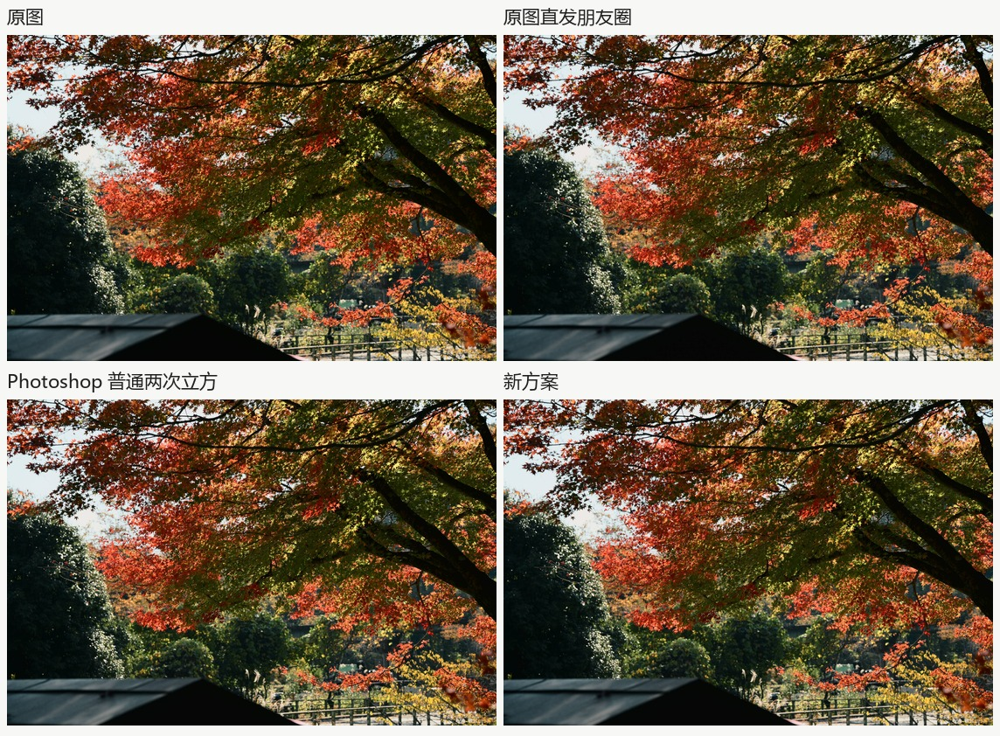
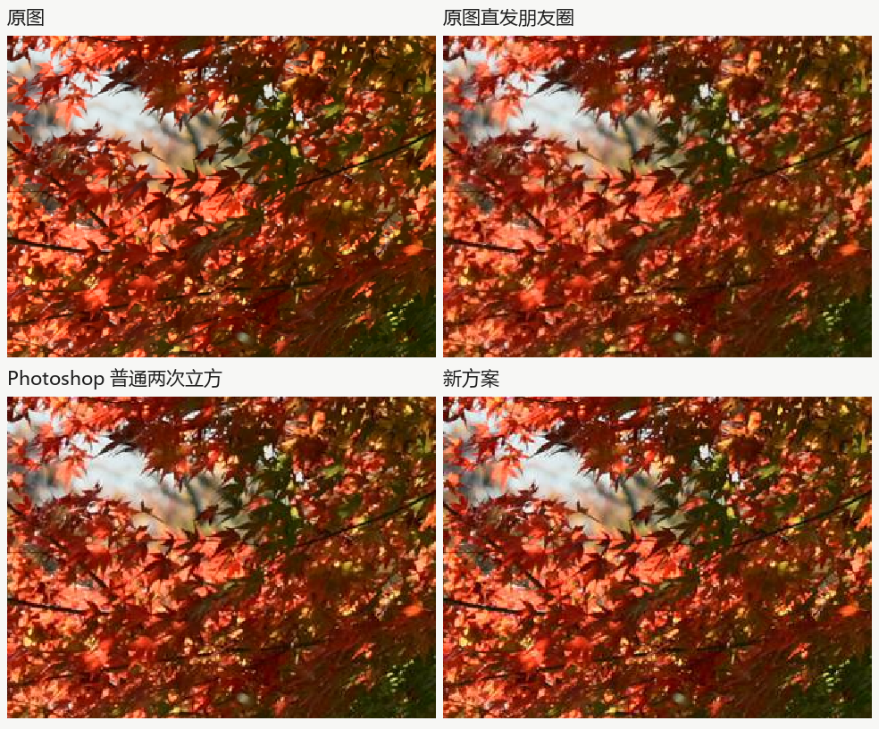
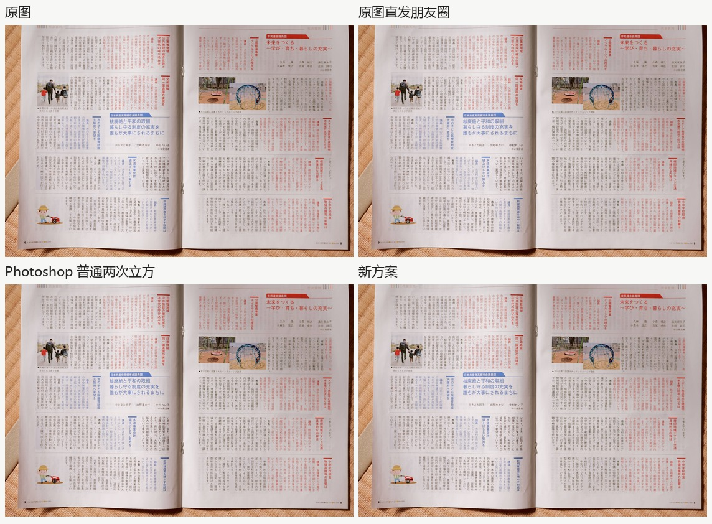
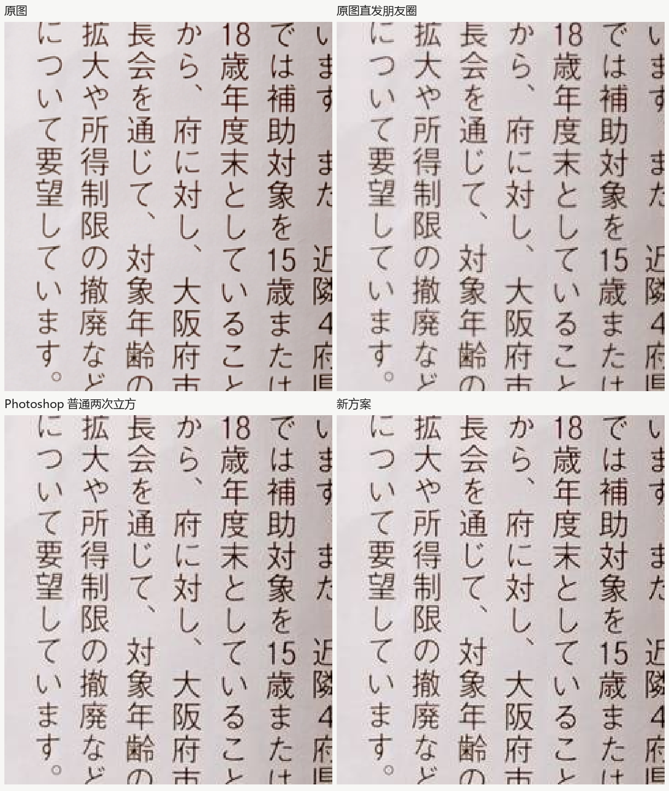
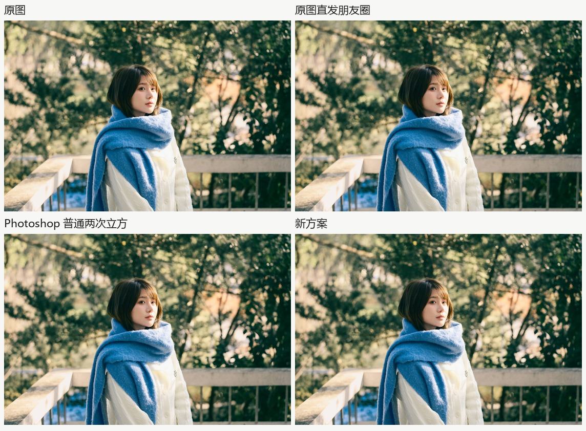
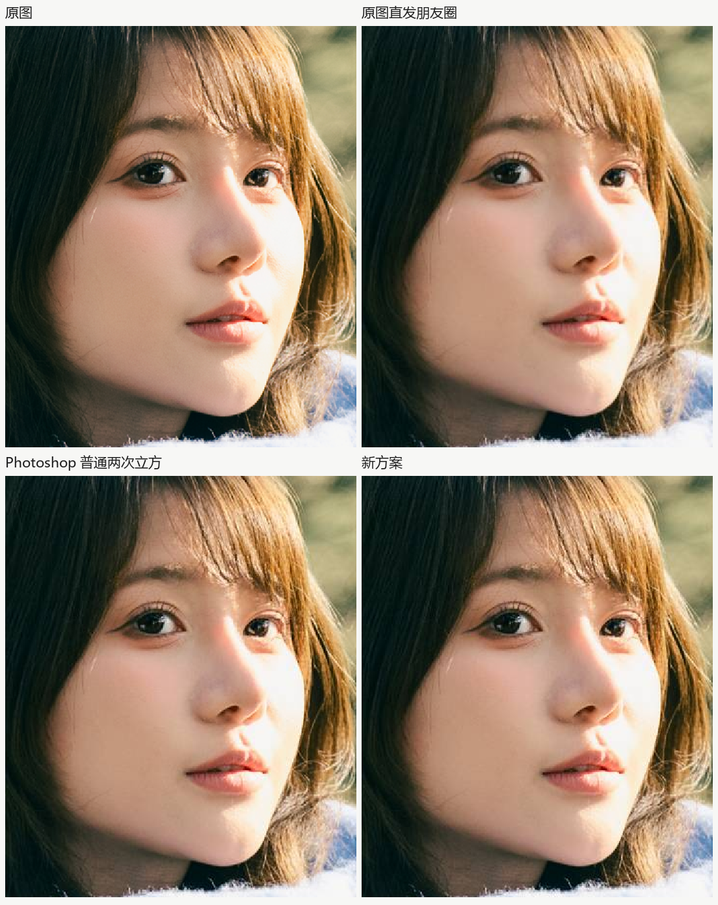

# 微信朋友圈照片压缩实测
同一张照片用三种方式发朋友圈，接收后保存，再和原图对照。下表及图版中的三种发送结果均来自实际回收文件。
| 场景 | 原图直发 | Photoshop 普通两次立方 | 新方案 |
|---|---:|---:|---:|
| 枫叶 | 66.97 | 70.89 | 71.47 |
| 杂志 | 72.31 | 73.48 | 73.68 |
| 人像 | 74.69 | 75.64 | 75.87 |

评分采用 SSIMULACRA2，数值越高表示越接近参考图。参考图由相机 JPEG 经 Lanczos3 等比例缩至 2880 × 1920，与新方案共用缩图方式。三张照片中，预缩图均优于原图直发。新方案相对 Photoshop 的分差分别为 0.58、0.20 和 0.23 分。这些分差不能直接换算成肉眼可见程度。

## 实验方法

Photoshop 组从原片用「两次立方（平滑渐变）」缩图，保存 PNG 后发送。新方案从 Lanczos3 缩图出发，在 JPEG Q70、4:2:0 的本地模拟中尝试不同的色度补偿强度，以像素误差和感知评分选档，再用 PNG 实发。枫叶、杂志、人像的系数分别为 0.75、0.25 和 0。人像的新方案与普通 Lanczos3 缩图像素相同。

每组可点击下载四张完整 JPEG。公开副本移除了拍摄元数据，已校验其解码像素与本地文件一致。细节图以 2880 × 1920 为坐标系，原图列先用无损保存的 Lanczos3 缩图对齐；其余三列直接取自回收 JPEG。放大采用最近邻，便于查看已有像素。点击图版可查看完整尺寸。

## 枫叶

[原图](maple/original.jpg) · [原图直发朋友圈](maple/direct.jpg) · [Photoshop 普通两次立方](maple/photoshop.jpg) · [新方案](maple/adaptive.jpg)

全图对照

距左边约三分之一、画面中部的叶片，放大 150%（裁切框 (800, 840, 1120, 1080)）

## 杂志

[原图](print/original.jpg) · [原图直发朋友圈](print/direct.jpg) · [Photoshop 普通两次立方](print/photoshop.jpg) · [新方案](print/adaptive.jpg)

全图对照

左页「水道事業会計」标题右侧的竖排正文，放大 250%（裁切框 (1110, 1095, 1350, 1365)）

## 人像

[原图](portrait/original.jpg) · [原图直发朋友圈](portrait/direct.jpg) · [Photoshop 普通两次立方](portrait/photoshop.jpg) · [新方案](portrait/adaptive.jpg)

全图对照

人物头部与发际线，放大 150%（裁切框 (1232, 536, 1592, 968)）

