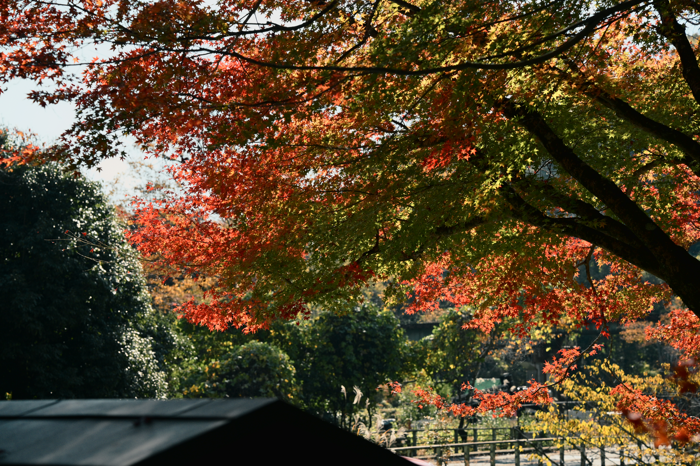
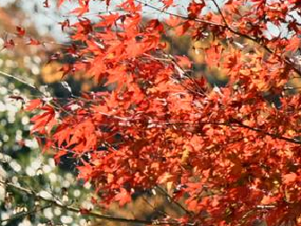

[返回实验报告](../README.md)

# 枫叶 · 叶尖与交错的枝条

画面从左数约五分之一处，取中部红叶与背景重叠的区域。

[完整照片](#完整照片)　 ·　 [同位置细节](#同位置细节)

## 完整照片

点击照片或下方的像素尺寸，可单独打开全分辨率文件。

### 相机原图

[6048 × 4032 像素 · JPEG](https://raw.githubusercontent.com/ZHUKECHENG666/wechat-moments-photo-study/main/maple/original.jpg)

### 原图直发朋友圈

[2880 × 1920 像素 · JPEG](https://raw.githubusercontent.com/ZHUKECHENG666/wechat-moments-photo-study/main/maple/direct.jpg)　｜　实收评分 66.97

### Photoshop 缩图后发朋友圈

[2880 × 1920 像素 · JPEG](https://raw.githubusercontent.com/ZHUKECHENG666/wechat-moments-photo-study/main/maple/photoshop.jpg)　｜　实收评分 70.89

### 新方案处理后发朋友圈

[2880 × 1920 像素 · JPEG](https://raw.githubusercontent.com/ZHUKECHENG666/wechat-moments-photo-study/main/maple/adaptive.jpg)　｜　实收评分 71.47

## 同位置细节

四幅图取同一片画面，点击可看各自的 PNG。朋友圈图在 2880 × 1920 上取框 (480, 840, 800, 1080)，局部以最近邻放至 105%。相机原图在 6048 × 4032 上取对应框 (1008, 1764, 1680, 2268)，直接保留框内全部 672 × 504 个像素。页面会随屏宽调整显示大小。

| 相机原图 · 原生像素 | 原图直发朋友圈 |
|---|---|
|  |  |
| **Photoshop 普通两次立方** | **新方案** |
|  |  |

## 实测结果

| 场景 | 发送方式 | 发送文件 MB | 实收文件 MB | 平均色差 ΔE76 ↓ | 新增粗糙度 ↓ | 综合评分 ↑ |
|---|---|---:|---:|---:|---:|---:|
| 枫叶 | 原图直发 | 18.653 | 1.043 | 4.341 | 1.941 | 66.97 |
| 枫叶 | Photoshop | 16.598 | 1.100 | 4.234 | 2.493 | 70.89 |
| 枫叶 | 新方案 | 10.534 | 1.120 | 4.219 | 2.569 | 71.47 |

[返回全部结果与指标说明](../README.md#实验结果)
