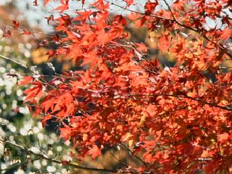

[返回实验报告](../README.md)

# 枫叶 · 叶尖与交错的枝条

画面左侧五分之一处，观察红叶边缘与背景枝条重叠的位置。

快速 CNN 发送稿为 **5.57 MB**，朋友圈实收 **1.12 MB**。预测与实收均为 **74.91 分**，解码后逐像素一致。

## 同位置细节

四幅图取同一片画面，点击可看各自的 PNG。朋友圈图在 2880 × 1920 上取框 (480, 840, 800, 1080)，局部以最近邻放至 105%。相机原图在 6048 × 4032 上取对应框 (1008, 1764, 1680, 2268)，直接保留框内全部 672 × 504 个像素。四格预览各为 336 × 252 像素，两列等宽。点击相机原图一格可查看上述原生像素裁切。

<table>
<tr><td width="50%" align="center"><strong>相机原图</strong> </td><td width="50%" align="center"><strong>原图直发</strong> </td></tr>
<tr><td width="50%" align="center"><strong>Photoshop 普通两次立方</strong> </td><td width="50%" align="center"><strong>快速 CNN · 轻量 JPG</strong> </td></tr>
</table>

## 实测结果

<table>
<thead><tr><th>场景</th><th>方案</th><th>发尺寸</th><th>收尺寸</th><th>对比原图的色差 ↓</th><th>综合评分 ↑</th></tr></thead>
<tbody>
<tr><th rowspan="3">枫叶</th><td>原图直发</td><td>6048×4032 18.653 MB</td><td>2880×1920 1.043 MB</td><td>4.341</td><td>66.97</td></tr>
<tr><td>Photoshop</td><td>2880×1920 16.598 MB</td><td>2880×1920 1.100 MB</td><td>4.234</td><td>70.89</td></tr>
<tr><td>快速 CNN · 轻量 JPG</td><td>2880×1920 5.573 MB</td><td>2880×1920 1.119 MB</td><td>4.392</td><td><strong>74.91</strong></td></tr>
</tbody>
</table>

把参考图及实收图统一缩到长边 1080 像素后，原图直发为 86.47 分，Photoshop 为 87.58 分，快速 CNN 为 88.67 分。

## 完整照片

点击下方任一照片可打开独立的全分辨率 JPEG。

### 相机原图

### 原图直发朋友圈

### Photoshop 缩图后发朋友圈

### 快速 CNN 轻量 JPG 发朋友圈

[返回总表与指标说明](../README.md#实验结果)
