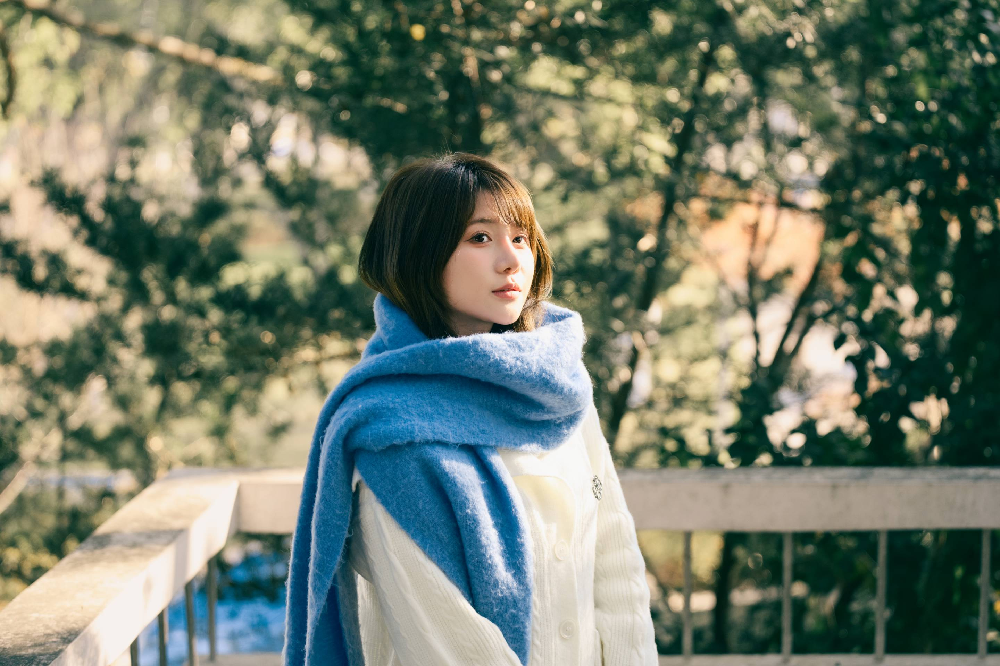

[返回实验报告](../README.md)

# 人像 · 发丝、眼周与肤色

取人物头部，可对照头发与背景的交界、眼周轮廓和脸颊上的色调过渡。

[完整照片](#完整照片)　 ·　 [同位置细节](#同位置细节)

## 完整照片

点击照片或下方的像素尺寸，可单独打开全分辨率文件。

### 相机原图

[5651 × 3767 像素 · JPEG](https://raw.githubusercontent.com/ZHUKECHENG666/wechat-moments-photo-study/main/portrait/original.jpg)

### 原图直发朋友圈

[2880 × 1920 像素 · JPEG](https://raw.githubusercontent.com/ZHUKECHENG666/wechat-moments-photo-study/main/portrait/direct.jpg)　｜　实收评分 74.69

### Photoshop 缩图后发朋友圈

[2880 × 1920 像素 · JPEG](https://raw.githubusercontent.com/ZHUKECHENG666/wechat-moments-photo-study/main/portrait/photoshop.jpg)　｜　实收评分 75.64

### 新方案处理后发朋友圈

[2880 × 1920 像素 · JPEG](https://raw.githubusercontent.com/ZHUKECHENG666/wechat-moments-photo-study/main/portrait/adaptive.jpg)　｜　实收评分 75.87

## 同位置细节

四幅图取同一片画面，点击可看各自的 PNG。朋友圈图在 2880 × 1920 上取框 (1232, 536, 1592, 968)，局部以最近邻放至 105%。相机原图在 5651 × 3767 上取对应框 (2417, 1052, 3124, 1899)，直接保留框内全部 707 × 847 个像素。四格预览各为 378 × 454 像素，两列等宽。点击相机原图一格可查看上述原生像素裁切。

<table>
<tr><td width="50%" align="center"><strong>相机原图</strong> </td><td width="50%" align="center"><strong>原图直发朋友圈</strong> </td></tr>
<tr><td width="50%" align="center"><strong>Photoshop 普通两次立方</strong> </td><td width="50%" align="center"><strong>新方案</strong> </td></tr>
</table>

## 实测结果

<table>
<thead><tr><th>场景</th><th>方案</th><th>发尺寸</th><th>收尺寸</th><th>对比原图的色差 ↓</th><th>对比原图的毛糙度 ↓</th><th>综合评分 ↑</th></tr></thead>
<tbody>
<tr><th rowspan="3">人像</th><td>原图直发</td><td>5651×3767 19.471 MB</td><td>2880×1920 0.438 MB</td><td>1.682</td><td>0.508</td><td>74.69</td></tr>
<tr><td>Photoshop</td><td>2880×1920 16.598 MB</td><td>2880×1920 0.461 MB</td><td>1.674</td><td>0.628</td><td>75.64</td></tr>
<tr><td>新方案</td><td>2880×1920 7.969 MB</td><td>2880×1920 0.461 MB</td><td>1.672</td><td>0.635</td><td>75.87</td></tr>
</tbody>
</table>

[全部场景总分与指标计算方法](../README.md#实验结果)
