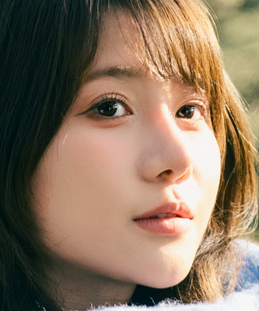

[返回实验报告](../README.md)

# 人像 · 眼周与发丝

取人物头部，观察发丝与背景的交界、眼周轮廓和肤色过渡。

快速 CNN 发送稿为 **3.13 MB**，朋友圈实收 **0.47 MB**。预测与实收均为 **77.33 分**，解码后逐像素一致。

## 同位置细节

四幅图取同一片画面，点击可看各自的 PNG。朋友圈图在 2880 × 1920 上取框 (1232, 536, 1592, 968)，局部以最近邻放至 105%。相机原图在 5651 × 3767 上取对应框 (2417, 1052, 3124, 1899)，直接保留框内全部 707 × 847 个像素。四格预览各为 378 × 454 像素，两列等宽。点击相机原图一格可查看上述原生像素裁切。

<table>
<tr><td width="50%" align="center"><strong>相机原图</strong> </td><td width="50%" align="center"><strong>原图直发</strong> </td></tr>
<tr><td width="50%" align="center"><strong>Photoshop 普通两次立方</strong> </td><td width="50%" align="center"><strong>快速 CNN · 轻量 JPG</strong> </td></tr>
</table>

## 实测结果

<table>
<thead><tr><th>场景</th><th>方案</th><th>发尺寸</th><th>收尺寸</th><th>对比原图的色差 ↓</th><th>综合评分 ↑</th></tr></thead>
<tbody>
<tr><th rowspan="3">人像</th><td>原图直发</td><td>5651×3767 19.471 MB</td><td>2880×1920 0.438 MB</td><td>1.682</td><td>74.69</td></tr>
<tr><td>Photoshop</td><td>2880×1920 16.598 MB</td><td>2880×1920 0.461 MB</td><td>1.674</td><td>75.64</td></tr>
<tr><td>快速 CNN · 轻量 JPG</td><td>2880×1920 3.133 MB</td><td>2880×1920 0.470 MB</td><td>1.709</td><td><strong>77.33</strong></td></tr>
</tbody>
</table>

把参考图及实收图统一缩到长边 1080 像素后，原图直发为 90.03 分，Photoshop 为 90.41 分，快速 CNN 为 90.62 分。

## 完整照片

点击下方任一照片可打开独立的全分辨率 JPEG。

### 相机原图

### 原图直发朋友圈

### Photoshop 缩图后发朋友圈

### 快速 CNN 轻量 JPG 发朋友圈

[返回总表与指标说明](../README.md#实验结果)
