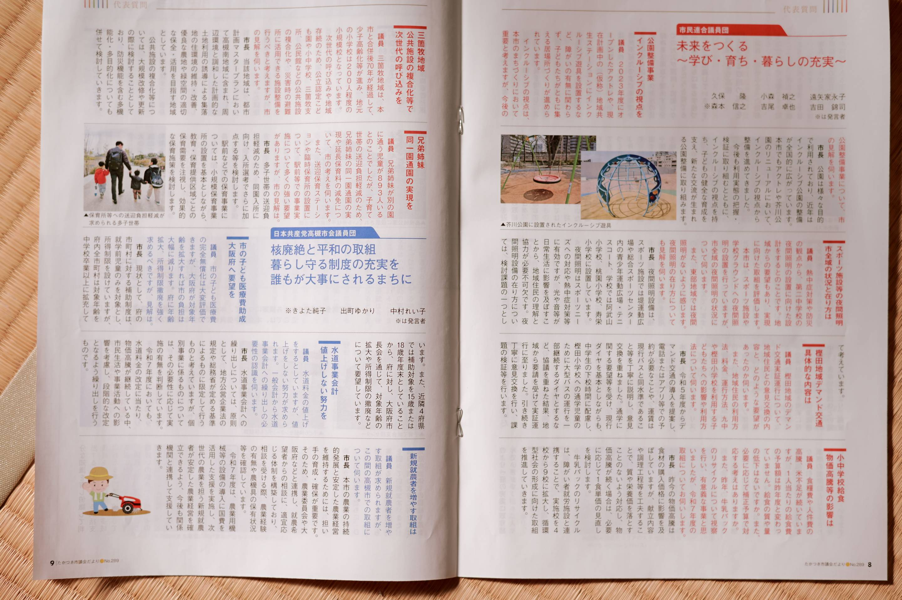
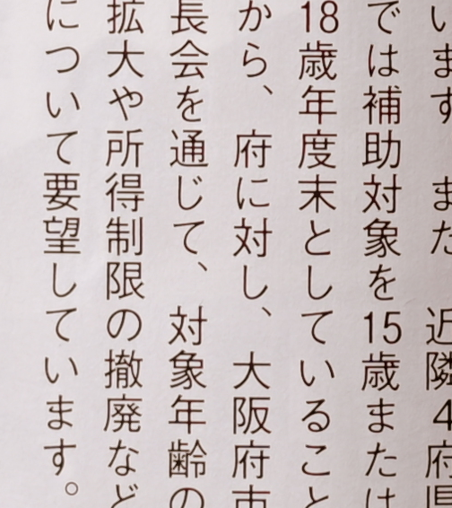
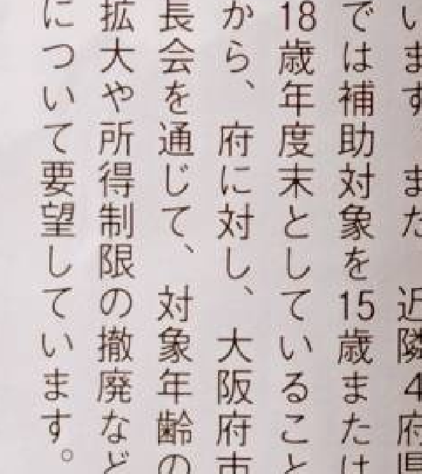

[返回实验报告](../README.md)

# 杂志 · 纸面上的竖排小字

取左页「水道事業会計」标题右侧的正文，可沿同一列观察细笔画与纸面颗粒。

[完整照片](#完整照片)　 ·　 [同位置细节](#同位置细节)

## 完整照片

点击照片或下方的像素尺寸，可单独打开全分辨率文件。

### 相机原图

[6048 × 4032 像素 · JPEG](https://raw.githubusercontent.com/ZHUKECHENG666/wechat-moments-photo-study/main/print/original.jpg)

### 原图直发朋友圈

[2880 × 1920 像素 · JPEG](https://raw.githubusercontent.com/ZHUKECHENG666/wechat-moments-photo-study/main/print/direct.jpg)　｜　实收评分 72.31

### Photoshop 缩图后发朋友圈

[2880 × 1920 像素 · JPEG](https://raw.githubusercontent.com/ZHUKECHENG666/wechat-moments-photo-study/main/print/photoshop.jpg)　｜　实收评分 73.48

### 新方案处理后发朋友圈

[2880 × 1920 像素 · JPEG](https://raw.githubusercontent.com/ZHUKECHENG666/wechat-moments-photo-study/main/print/adaptive.jpg)　｜　实收评分 73.68

## 同位置细节

四幅图取同一片画面，点击可看各自的 PNG。朋友圈图在 2880 × 1920 上取框 (1110, 1095, 1350, 1365)，局部以最近邻放至 175%。相机原图在 6048 × 4032 上取对应框 (2331, 2300, 2835, 2866)，直接保留框内全部 504 × 566 个像素。页面会随屏宽调整显示大小。

| 相机原图 · 原生像素 | 原图直发朋友圈 |
|---|---|
|  |  |
| **Photoshop 普通两次立方** | **新方案** |
|  |  |

## 实测结果

| 场景 | 发送方式 | 发送文件 MB | 实收文件 MB | 平均色差 ΔE76 ↓ | 新增粗糙度 ↓ | 综合评分 ↑ |
|---|---|---:|---:|---:|---:|---:|
| 杂志 | 原图直发 | 11.264 | 0.524 | 1.979 | 1.042 | 72.31 |
| 杂志 | Photoshop | 16.597 | 0.550 | 1.946 | 1.306 | 73.48 |
| 杂志 | 新方案 | 7.233 | 0.553 | 1.945 | 1.341 | 73.68 |

[返回全部结果与指标说明](../README.md#实验结果)
