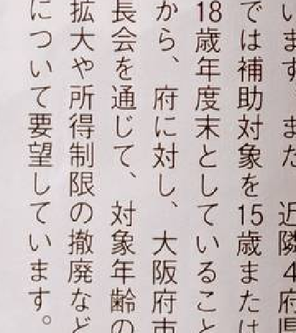

[返回实验报告](../README.md)

# 杂志 · 纸面上的竖排小字

取左页「水道事業会計」标题右侧的正文，可沿同一列观察细笔画与纸面颗粒。

[完整照片](#完整照片)　 ·　 [同位置细节](#同位置细节)

## 完整照片

点击照片或下方的像素尺寸，可单独打开全分辨率文件。

### 相机原图

[6048 × 4032 像素 · JPEG](https://raw.githubusercontent.com/ZHUKECHENG666/wechat-moments-photo-study/main/print/original.jpg)

### 原图直发朋友圈

[2880 × 1920 像素 · JPEG](https://raw.githubusercontent.com/ZHUKECHENG666/wechat-moments-photo-study/main/print/direct.jpg)　｜　实收评分 72.31

### Photoshop 缩图后发朋友圈

[2880 × 1920 像素 · JPEG](https://raw.githubusercontent.com/ZHUKECHENG666/wechat-moments-photo-study/main/print/photoshop.jpg)　｜　实收评分 73.48

### 新方案处理后发朋友圈

[2880 × 1920 像素 · JPEG](https://raw.githubusercontent.com/ZHUKECHENG666/wechat-moments-photo-study/main/print/adaptive.jpg)　｜　实收评分 73.68

## 同位置细节

四幅图取同一片画面，点击可看各自的 PNG。朋友圈图在 2880 × 1920 上取框 (1110, 1095, 1350, 1365)，局部以最近邻放至 175%。相机原图在 6048 × 4032 上取对应框 (2331, 2300, 2835, 2866)，直接保留框内全部 504 × 566 个像素。四格预览各为 420 × 473 像素，两列等宽。点击相机原图一格可查看上述原生像素裁切。

<table>
<tr><td width="50%" align="center"><strong>相机原图</strong> </td><td width="50%" align="center"><strong>原图直发朋友圈</strong> </td></tr>
<tr><td width="50%" align="center"><strong>Photoshop 普通两次立方</strong> </td><td width="50%" align="center"><strong>新方案</strong> </td></tr>
</table>

## 实测结果

<table>
<thead><tr><th>场景</th><th>方案</th><th>发尺寸</th><th>收尺寸</th><th>对比原图的色差 ↓</th><th>对比原图的毛糙度 ↓</th><th>综合评分 ↑</th></tr></thead>
<tbody>
<tr><th rowspan="3">杂志</th><td>原图直发</td><td>6048×4032 11.264 MB</td><td>2880×1920 0.524 MB</td><td>1.979</td><td>1.042</td><td>72.31</td></tr>
<tr><td>Photoshop</td><td>2880×1920 16.597 MB</td><td>2880×1920 0.550 MB</td><td>1.946</td><td>1.306</td><td>73.48</td></tr>
<tr><td>新方案</td><td>2880×1920 7.233 MB</td><td>2880×1920 0.553 MB</td><td>1.945</td><td>1.341</td><td>73.68</td></tr>
</tbody>
</table>

[全部场景总分与指标计算方法](../README.md#实验结果)
