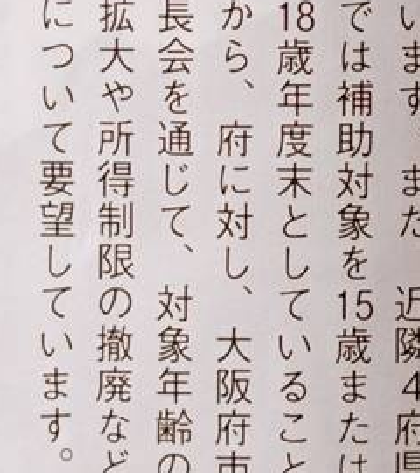

[返回实验报告](../README.md)

# 杂志 · 竖排小字

对照左页「水道事業会計」右侧的正文，观察细笔画之间的空隙。

快速 CNN 发送稿为 **2.96 MB**，朋友圈实收 **0.56 MB**。预测与实收均为 **75.49 分**，解码后逐像素一致。

## 同位置细节

四幅图取同一片画面，点击可看各自的 PNG。朋友圈图在 2880 × 1920 上取框 (1110, 1095, 1350, 1365)，局部以最近邻放至 175%。相机原图在 6048 × 4032 上取对应框 (2331, 2300, 2835, 2866)，直接保留框内全部 504 × 566 个像素。四格预览各为 420 × 473 像素，两列等宽。点击相机原图一格可查看上述原生像素裁切。

<table>
<tr><td width="50%" align="center"><strong>相机原图</strong> </td><td width="50%" align="center"><strong>原图直发</strong> </td></tr>
<tr><td width="50%" align="center"><strong>Photoshop 普通两次立方</strong> </td><td width="50%" align="center"><strong>快速 CNN · 轻量 JPG</strong> </td></tr>
</table>

## 实测结果

<table>
<thead><tr><th>场景</th><th>方案</th><th>发尺寸</th><th>收尺寸</th><th>对比原图的色差 ↓</th><th>综合评分 ↑</th></tr></thead>
<tbody>
<tr><th rowspan="3">杂志</th><td>原图直发</td><td>6048×4032 11.264 MB</td><td>2880×1920 0.524 MB</td><td>1.979</td><td>72.31</td></tr>
<tr><td>Photoshop</td><td>2880×1920 16.597 MB</td><td>2880×1920 0.550 MB</td><td>1.946</td><td>73.48</td></tr>
<tr><td>快速 CNN · 轻量 JPG</td><td>2880×1920 2.956 MB</td><td>2880×1920 0.558 MB</td><td>2.011</td><td><strong>75.49</strong></td></tr>
</tbody>
</table>

把参考图及实收图统一缩到长边 1080 像素后，原图直发为 88.21 分，Photoshop 为 88.59 分，快速 CNN 为 88.97 分。

## 完整照片

点击下方任一照片可打开独立的全分辨率 JPEG。

### 相机原图

### 原图直发朋友圈

### Photoshop 缩图后发朋友圈

### 快速 CNN 轻量 JPG 发朋友圈

[返回总表与指标说明](../README.md#实验结果)
